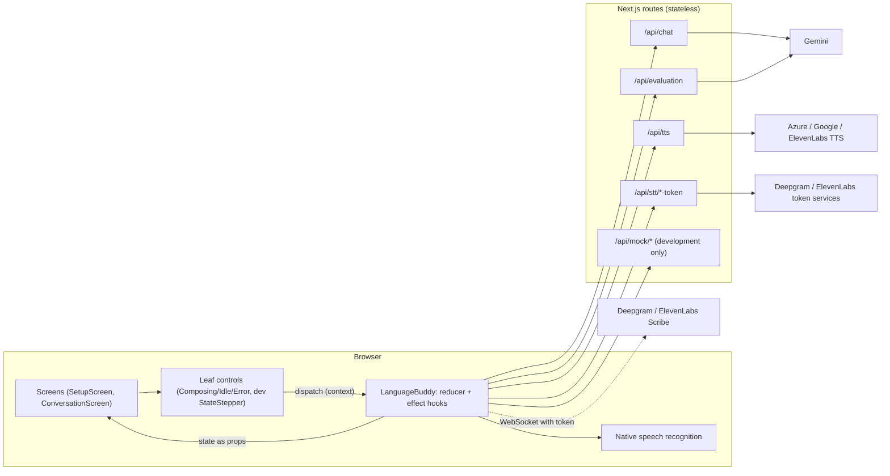
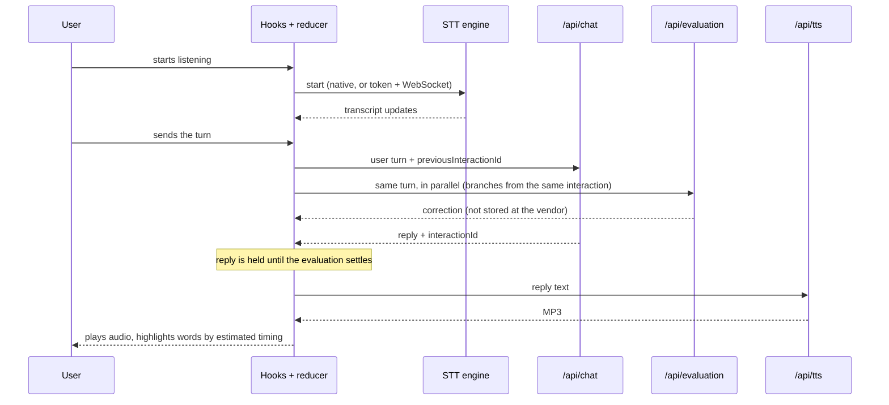

# Software architecture — language-buddy

**Lens.** The technical view: what the components are, how they connect, how credentials
move, what differs between environments. The frontend is covered as structure — which
components exist, how state and actions flow through them — not as product or visual
design: copy, layout and the design system are a different perspective and are not covered
here (see `src/components/CLAUDE.md` and ADR-022 (Design system overgenomen uit de bestaande app) for those).

**Reading guide.** Wanting the whole chain: sections 1 and 4. Working on a provider or a
route: sections 3 and 6. Working on a screen or a component: sections 2 and 3. Touching
deployment or env vars: sections 5 and 6.

**Source of decisions.** Each decision cited here points to a record under
`docs/grootboek/` (ADR, PDR or HDR), cited with its id and title. The decisions that used to
live in `docs/plan.md` were moved into such records when the plan was retired (HDR-015,
plan.md vervalt als bron; beslissingen leven in het grootboek). A choice marked *candidate*
shows in the code but has no decision record anywhere.

## 1. The system and the choices that make it possible

A browser app that lets one person practise spoken conversation in a foreign language
against an AI persona: speech in, a reply from a language model, speech out, with a
per-turn correction.

1. **The server is stateless.** Every route is a plain request/response handler; no
   long-lived process and no WebSocket server of our own. The conversation history lives at
   the model vendor and is chained with `previous_interaction_id`; the server keeps nothing.
   *Decision:* ADR-014 (Hosting: Vercel), PDR-002 (Geen persistentie), ADR-019 (Chat-API en
   gespreksgeschiedenis).
2. **No vendor key reaches the browser.** Keys are server-side env vars. Vendors the
   browser must talk to directly (live speech recognition over WebSocket) get a short-lived
   token minted by one of our routes. *Decision:* ADR-014 (Hosting: Vercel),
   ADR-011 (Deepgram-provider), ADR-012 (ElevenLabs Scribe-provider); the reason is also in
   comments in the token routes.
3. **One reducer is the only writer of session state; effects live in hooks.** State
   changes only through actions to a pure reducer; the hooks drive the network and audio and
   dispatch the results. *Decision:* ADR-018 (Sessiestate: één reducer, beurtstatus als discriminated union).
4. **Providers sit behind registries and an unknown setting fails loudly.** TTS and STT
   engines are chosen by an env var; a typo throws with the valid names instead of quietly
   picking another provider. *Decision:* ADR-020 (TTS-providers en stemmen), ADR-009 (STT:
   providerkeuze en configuratie); the reason for "no fallback" is in the registry comments.

## 2. Component map

Only four components call `useSessionDispatch()` directly: `ComposingControls`,
`IdleControls`, `ErrorControls` and the dev-only `StateStepper`. Everything else in
`SCREENS` and the presentational pieces between `SCREENS` and `CTRL` (the thread, the
bubbles, the evaluation display, the setup form fields) only receive state and callbacks as
props — they never touch the reducer directly.

## 3. Components: responsibilities and decisions

| Component | Responsibility | Decision behind it |
|---|---|---|
| Session reducer (`src/lib/session-reducer.ts`) | The state machine: setup vs conversation, and the turn-state union. The only writer of session state. | ADR-018 (Sessiestate: één reducer, beurtstatus als discriminated union) |
| Effect hooks (`src/hooks/`) | One driver per concern: chat call, evaluation call, audio playback, live transcription, mock TTS. Each reacts to a turn state and dispatches results. | ADR-018 (Sessiestate: één reducer, beurtstatus als discriminated union) |
| TTS registry and providers (`src/lib/tts/`) | Pick one provider by `TTS_PROVIDER` (default Azure), turn text into MP3. Voice tables live inside each provider. | ADR-020 (TTS-providers en stemmen) |
| STT registry and providers (`src/lib/stt/`) | Pick one engine by `NEXT_PUBLIC_STT_PROVIDER` (default native): native Web Speech, Deepgram, ElevenLabs Scribe. One start-function contract. | ADR-009 (STT: providerkeuze en configuratie) |
| Chat and evaluation routes (`src/app/api/chat`, `evaluation`) | Call Gemini: the conversation turn, and a separate correction of the user's turn. Error details stay in the server log. | ADR-007 (Evaluatie per beurt, in een eigen call), ADR-019 (Chat-API en gespreksgeschiedenis) |
| TTS route (`src/app/api/tts`) | Validate the body, synthesise with the configured provider, return audio. The voice gender is fixed on the server. | ADR-020 (TTS-providers en stemmen) |
| Token routes (`src/app/api/stt/*-token`) | Exchange the server-side key for a short-lived token for the browser. | ADR-011 (Deepgram-provider), ADR-012 (ElevenLabs Scribe-provider) |
| Mock routes (`src/app/api/mock/*`) | Canned chat and evaluation replies; 404 outside development. | ADR-025 (Mockmodus voor ontwikkeling) |
| Prompt builder (`src/lib/prompt.ts`) | Builds the system instruction for the chat call and for the correction call, on every request. | ADR-019 (Chat-API en gespreksgeschiedenis), ADR-008 (Prompts van de corrector) |
| Contracts (`src/lib/chat-schema.ts`, `tts/types.ts`, `stt/types.ts`) | The request/response shapes and the provider interfaces, shared by routes, hooks and providers. | ADR-020 (TTS-providers en stemmen), ADR-019 (Chat-API en gespreksgeschiedenis) |
| App shell (`src/app/layout.tsx`, `page.tsx`, `manifest.ts`) | Fonts, PWA manifest, global CSS, mounts `LanguageBuddy` as the one page. | — |
| `LanguageBuddy` (`src/components/language-buddy.tsx`) | Owns the reducer, wires every effect hook, renders exactly one screen for the current `phase`, provides `dispatch` through context. | ADR-018 (Sessiestate: één reducer, beurtstatus als discriminated union) |
| Screens (`SetupScreen`, `ConversationScreen`) and the presentational pieces under them (thread, bubbles, evaluation display, form fields) | Receive state and callbacks as props; render; never call `dispatch` directly. | ADR-018 (Sessiestate: één reducer, beurtstatus als discriminated union) |
| Leaf controls (`ComposingControls`, `IdleControls`, `ErrorControls`, dev-only `StateStepper`) | The only components that call `useSessionDispatch()`. `ConversationControls` switches on `turnState.name` to render exactly one of them. | The code (`src/components/conversation/conversation-controls.tsx`); no record |

## 4. Core data flow: one conversation turn

**Bounds on waiting:** the chat call has a client-side deadline of 30 s and the evaluation
10 s; the evaluation deadline is therefore the longest a reply can be held back. Playback
is cut slightly before the end of the audio, because of a problem observed on iPhone (cause
unknown; JNL-004 (Openstaande kwesties), K9; mitigation in ADR-010 (Native engine op iPhone:
herstart en twee mitigaties)).

**Current model, marked explicitly:** the evaluation is a separate call that branches from
the conversation and does not return into the chain; the AI reply is held until the
evaluation of the preceding turn has settled, so a correction never appears after the reply.
Word highlighting uses an estimate from text length, not provider timing.

**Where the two user actions in the diagram originate:** "starts listening" is
`IdleControls` dispatching `LISTENING_STARTED`; "sends the turn" is `ComposingControls`
dispatching `USER_TURN_SENT`. Both are leaf controls (see section 3); nothing between them
and `LanguageBuddy` touches the reducer.

## 5. Environments

| | Local development | Deployed |
|---|---|---|
| Runs as | `next dev`, optionally behind an HTTPS tunnel for iPhone tests (the dev server allows `*.ngrok-free.app`) | Vercel (named in README and ADR-014, Hosting: Vercel; no configuration file in the repo) |
| Mock chat / evaluation | `NEXT_PUBLIC_USE_MOCK_CHAT` switches both together; the mock routes answer only in development | Mock routes return 404 |
| Mock TTS | `NEXT_PUBLIC_USE_MOCK_TTS` | Not limited to development: it runs in the browser, so no server check applies (ADR-025, Mockmodus voor ontwikkeling) |
| Provider choice | `TTS_PROVIDER` (server), `NEXT_PUBLIC_STT_PROVIDER` (baked in at build) | same variables |

`main` is the production branch; every other branch deploys as a Vercel preview with
Vercel's default settings, so nothing but a merge into `main` reaches production (ADR-001;
this is configured in the Vercel dashboard, not in the repo). The `NEXT_PUBLIC_*`
variables are enabled for Preview too; the API keys are enabled for Production only, so a
preview builds but its vendor-calling routes fail at runtime and it cannot spend a key.
Vercel Authentication is active with Standard Protection: previews ask for a Vercel login;
the production domain is public (ADR-002 covers what that leaves open).
There is no CI workflow in the repo; the checks are the ones listed in `CLAUDE.md`. Running
them on pull requests to `main` is wanted but not built (HDR-003; JNL-001, K8).

## 6. Service authentication

| Relationship | Mechanism | Secret / variable | Where it lives |
|---|---|---|---|
| Server → Gemini | API key | `GEMINI_API_KEY` | server only |
| Server → Azure TTS | subscription key header | `AZURE_SPEECH_API_KEY`, `AZURE_SPEECH_REGION` | server only |
| Server → Google TTS | API key as a header (`x-goog-api-key`) | `GOOGLE_CLOUD_API_KEY` | server only |
| Server → ElevenLabs TTS | key header | `ELEVENLABS_API_KEY` | server only |
| Server → ElevenLabs token service | key header; returns a single-use token | `ELEVENLABS_API_KEY` | server only |
| Browser → ElevenLabs Scribe | single-use token as a query parameter on the WebSocket URL | token from our route | browser, short-lived |
| Server → Deepgram grant | `Authorization` header (Token scheme); returns an access token | `DEEPGRAM_API_KEY` | server only |
| Browser → Deepgram | access token as the WebSocket `Bearer` subprotocol | token from our route | browser, short-lived |
| Browser → our routes | none found | none | — |

Public by design: `NEXT_PUBLIC_STT_PROVIDER`, `NEXT_PUBLIC_USE_MOCK_CHAT`,
`NEXT_PUBLIC_USE_MOCK_TTS` (they end up in the client bundle). Where two platforms must
agree on a secret: none found.

## 7. Shared contracts

| Contract | Defined in | Consumed by |
|---|---|---|
| Session state, turn state, actions | `src/lib/session-reducer.ts` | every effect hook and the screens |
| Chat and evaluation request/response (zod; the chat request is a union discriminated on `kind`) | `src/lib/chat-schema.ts` | hooks and routes |
| TTS provider and request body | `src/lib/tts/types.ts` | TTS providers, registry, route, playback hook |
| STT start function and callbacks | `src/lib/stt/types.ts` | the three STT engines and the live-transcription hook |
| Languages (per-vendor language codes) | `src/lib/languages.ts` | STT and TTS providers, prompt builder |

## 8. Technology choices, and what was not chosen

| Choice | Reason | Not chosen |
|---|---|---|
| Next.js App Router + TypeScript strict | ADR-013 (Next.js 16 met TypeScript strict) | — |
| Vercel hosting | ADR-014 (Hosting: Vercel) | a long-lived server process |
| CSS Modules | ADR-015 (Styling: CSS Modules over het overgenomen design system) | Tailwind |
| `useReducer` + dispatch context | ADR-018 (Sessiestate: één reducer, beurtstatus als discriminated union) | a state-management library |
| Gemini for chat and correction | The provider was specified up front; the model (`flash-lite`) was chosen on price, without an extensive comparison (ADR-003, Gemini `flash-lite` as the model, chosen on price) | other models were not compared |
| Azure TTS as default | ADR-020 (TTS-providers en stemmen) | — |
| Native Web Speech as default STT | ADR-009 (STT: providerkeuze en configuratie) | Google Cloud STT and Azure STT, ruled out in the spike (ADR-009, Voorgeschiedenis) |
| No persistence | PDR-002 (Geen persistentie) | storing conversations |

## 9. Security principles and where they live

| Principle | Implementation |
|---|---|
| A vendor key never reaches the client | keys read only in server code; browser gets minted tokens |
| Provider error details stay out of responses | the routes log the detail and return a generic message |
| The mock chat and evaluation routes cannot answer in production | they return 404 unless `NODE_ENV` is `development`. The TTS mock is a browser-side flag with no such gate (see section 5) |
| Values that enter a system prompt are constrained | `language` and `level` are zod enums in the request schema |
| Input size is bounded | the chat input and the text sent to TTS have length limits in their zod schemas |
| An abandoned request stops the vendor call | the route's request signal is passed on to the Gemini and TTS calls |
| Callers of our own routes | no principle found; no authentication or rate limit in the repo. The risk is accepted for now and a fix is wanted soon (ADR-002, provisional; JNL-001, K7) |

## 10. How this document changes

First the decision (a record: an ADR, PDR or HDR), then the update of
this document, and the human is told what changed and asked for a check. Facts that move
fast (dependency versions, line counts, the provider list) are measured from the code, not
kept here. Sections without a decision behind them say so; an honest gap is better than a
plausible filler.
