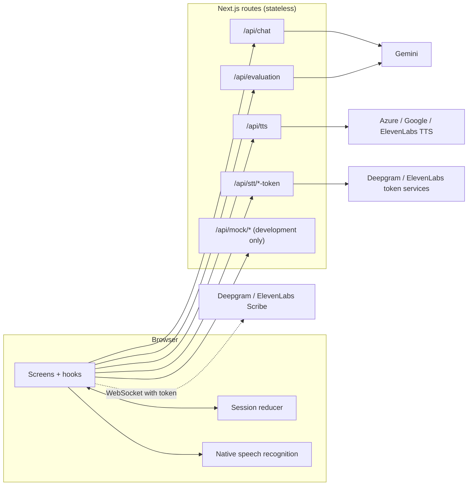
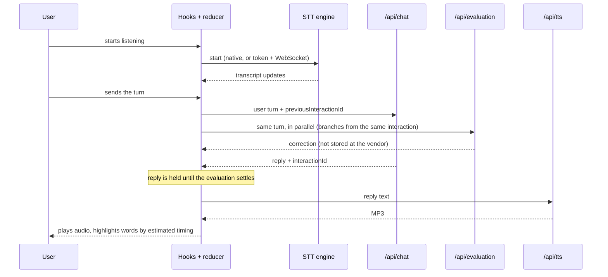

# Software architecture — language-buddy

**Lens.** The technical view: what the components are, how they connect, how credentials
move, what differs between environments. What the user experiences (screens, copy, design
system) and how human and agent work together are other perspectives and are not covered.

**Reading guide.** Wanting the whole chain: sections 1 and 4. Working on a provider or a
route: sections 3 and 6. Touching deployment or env vars: sections 5 and 6.

**Source of decisions.** There are no ADRs yet. "Decision" references point to rows in
`docs/plan.md` (the "Decisions" table or the "Decision log"). A choice marked *candidate*
shows in the code but has no decision record anywhere (see HDR-001 for why).

## 1. The system and the choices that make it possible

A browser app that lets one person practise spoken conversation in a foreign language
against an AI persona: speech in, a reply from a language model, speech out, with a
per-turn correction.

1. **The server is stateless.** Every route is a plain request/response handler; no
   long-lived process and no WebSocket server of our own. The conversation history lives at
   the model vendor and is chained with `previous_interaction_id`; the server keeps nothing.
   *Decision:* plan.md → Decisions (Hosting, Persistence, Conversation history).
2. **No vendor key reaches the browser.** Keys are server-side env vars. Vendors the
   browser must talk to directly (live speech recognition over WebSocket) get a short-lived
   token minted by one of our routes. *Decision:* plan.md → Decisions (Hosting);
   the reason is also in comments in the token routes.
3. **One reducer is the only writer of session state; effects live in hooks.** State
   changes only through actions to a pure reducer; the hooks drive the network and audio and
   dispatch the results. *Decision:* plan.md → Decisions (State, Turn states, Turn identity).
4. **Providers sit behind registries and an unknown setting fails loudly.** TTS and STT
   engines are chosen by an env var; a typo throws with the valid names instead of quietly
   picking another provider. *Decision:* plan.md → Decisions (TTS providers, STT providers);
   the reason for "no fallback" is in the registry comments.

## 2. Component map

## 3. Components: responsibilities and decisions

| Component | Responsibility | Decision behind it |
|---|---|---|
| Session reducer (`src/lib/session-reducer.ts`) | The state machine: setup vs conversation, and the turn-state union. The only writer of session state. | plan.md → Decisions: State, Turn states, Turn identity |
| Effect hooks (`src/hooks/`) | One driver per concern: chat call, evaluation call, audio playback, live transcription, mock TTS. Each reacts to a turn state and dispatches results. | plan.md → Decisions: State |
| TTS registry and providers (`src/lib/tts/`) | Pick one provider by `TTS_PROVIDER` (default Azure), turn text into MP3. Voice tables live inside each provider. | plan.md → Decisions: TTS providers, Voice tables |
| STT registry and providers (`src/lib/stt/`) | Pick one engine by `NEXT_PUBLIC_STT_PROVIDER` (default native): native Web Speech, Deepgram, ElevenLabs Scribe. One start-function contract. | plan.md → Decisions: STT providers |
| Chat and evaluation routes (`src/app/api/chat`, `evaluation`) | Call Gemini: the conversation turn, and a separate correction of the user's turn. Error details stay in the server log. | plan.md → Build stages: Stage 4 ("per-turn correction, in its own call") and its Decision log rows |
| TTS route (`src/app/api/tts`) | Validate the body, synthesise with the configured provider, return audio. The voice gender is fixed on the server. | plan.md → Decision log (10-03, gender) |
| Token routes (`src/app/api/stt/*-token`) | Exchange the server-side key for a short-lived token for the browser. | plan.md → Decisions: Hosting |
| Mock routes (`src/app/api/mock/*`) | Canned chat and evaluation replies; 404 outside development. | plan.md → Decision log (10-03, the chat mock; 10-08, the evaluation mock) |
| Prompt builder (`src/lib/prompt.ts`) | Builds the system instruction for the chat call and for the correction call, on every request. | plan.md → Build stages (stages 2 and 4) |
| Contracts (`src/lib/chat-schema.ts`, `tts/types.ts`, `stt/types.ts`) | The request/response shapes and the provider interfaces, shared by routes, hooks and providers. | plan.md → Decisions: Provider interface |

## 4. Core data flow: one conversation turn

**Bounds on waiting:** the chat call has a client-side deadline of 30 s and the evaluation
10 s; the evaluation deadline is therefore the longest a reply can be held back. Playback
is cut slightly before the end of the audio, because of a problem observed on iPhone (cause
unknown; plan.md → Open questions, 14).

**Current model, marked explicitly:** the evaluation is a separate call that branches from
the conversation and does not return into the chain; the AI reply is held until the
evaluation of the preceding turn has settled, so a correction never appears after the reply.
Word highlighting uses an estimate from text length, not provider timing.

## 5. Environments

| | Local development | Deployed |
|---|---|---|
| Runs as | `next dev`, optionally behind an HTTPS tunnel for iPhone tests (the dev server allows `*.ngrok-free.app`) | Vercel (named in README and plan; no configuration file in the repo) |
| Mock chat / evaluation | `NEXT_PUBLIC_USE_MOCK_CHAT` switches both together; the mock routes answer only in development | Mock routes return 404 |
| Mock TTS | `NEXT_PUBLIC_USE_MOCK_TTS` | Not limited to development: it runs in the browser, so no server check applies (plan.md → Decision log, 10-03) |
| Provider choice | `TTS_PROVIDER` (server), `NEXT_PUBLIC_STT_PROVIDER` (baked in at build) | same variables |

`main` is the production branch; every other branch deploys as a Vercel preview with
Vercel's default settings, so nothing but a merge into `main` reaches production (JNL-001,
K2; this is configured in the Vercel dashboard, not in the repo). The `NEXT_PUBLIC_*`
variables are enabled for Preview too; the API keys are enabled for Production only, so a
preview builds but its vendor-calling routes fail at runtime and it cannot spend a key.
Vercel Authentication is active with Standard Protection: previews ask for a Vercel login;
the production domain is public.
There is no CI workflow in the repo; the checks are the ones listed in `CLAUDE.md`. Running
them on pull requests to `main` is wanted but not built (JNL-001, K4 and K8).

## 6. Service authentication

| Relationship | Mechanism | Secret / variable | Where it lives |
|---|---|---|---|
| Server → Gemini | API key | `GEMINI_API_KEY` | server only |
| Server → Azure TTS | subscription key header | `AZURE_SPEECH_API_KEY`, `AZURE_SPEECH_REGION` | server only |
| Server → Google TTS | API key as URL query parameter | `GOOGLE_CLOUD_API_KEY` | server only |
| Server → ElevenLabs TTS | key header | `ELEVENLABS_API_KEY` | server only |
| Server → ElevenLabs token service | key header; returns a single-use token | `ELEVENLABS_API_KEY` | server only |
| Browser → ElevenLabs Scribe | single-use token as a query parameter on the WebSocket URL | token from our route | browser, short-lived |
| Server → Deepgram grant | `Authorization` header (Token scheme); returns an access token | `DEEPGRAM_API_KEY` | server only |
| Browser → Deepgram | access token as the WebSocket `Bearer` subprotocol | token from our route | browser, short-lived |
| Browser → our routes | none found | none | — |

Public by design: `NEXT_PUBLIC_STT_PROVIDER`, `NEXT_PUBLIC_USE_MOCK_CHAT`,
`NEXT_PUBLIC_USE_MOCK_TTS` (they end up in the client bundle). Where two platforms must
agree on a secret: none found.

## 7. Shared contracts

| Contract | Defined in | Consumed by |
|---|---|---|
| Session state, turn state, actions | `src/lib/session-reducer.ts` | every effect hook and the screens |
| Chat and evaluation request/response (zod; the chat request is a union discriminated on `kind`) | `src/lib/chat-schema.ts` | hooks and routes |
| TTS provider and request body | `src/lib/tts/types.ts` | TTS providers, registry, route, playback hook |
| STT start function and callbacks | `src/lib/stt/types.ts` | the three STT engines and the live-transcription hook |
| Languages (per-vendor language codes) | `src/lib/languages.ts` | STT and TTS providers, prompt builder |

## 8. Technology choices, and what was not chosen

| Choice | Reason | Not chosen |
|---|---|---|
| Next.js App Router + TypeScript strict | plan.md → Decisions: Framework | — |
| Vercel hosting | plan.md → Decisions: Hosting | a long-lived server process |
| CSS Modules | plan.md → Decisions: Styling | Tailwind |
| `useReducer` + dispatch context | plan.md → Decisions: State | a state-management library |
| Gemini for chat and correction | The provider was specified up front (plan.md → Fixed constraints); the model (`flash-lite`) was chosen on price, without an extensive comparison (JNL-001, K5) | other models were not compared |
| Azure TTS as default | plan.md → Decisions: TTS providers | — |
| Native Web Speech as default STT | plan.md → Decision log (10-12, 10-14) | Google Cloud STT and Azure STT, ruled out in the spike (plan.md → Decisions: STT providers) |
| No persistence | plan.md → Decisions: Persistence | storing conversations |

## 9. Security principles and where they live

| Principle | Implementation |
|---|---|
| A vendor key never reaches the client | keys read only in server code; browser gets minted tokens |
| Provider error details stay out of responses | the routes log the detail and return a generic message |
| The mock chat and evaluation routes cannot answer in production | they return 404 unless `NODE_ENV` is `development`. The TTS mock is a browser-side flag with no such gate (see section 5) |
| Values that enter a system prompt are constrained | `language` and `level` are zod enums in the request schema |
| Input size is bounded | the chat input and the text sent to TTS have length limits in their zod schemas |
| An abandoned request stops the vendor call | the route's request signal is passed on to the Gemini and TTS calls |
| Callers of our own routes | no principle found; no authentication or rate limit in the repo. The risk is accepted for now and a fix is wanted soon (JNL-001, K3 and K7) |

## 10. How this document changes

First the decision (an ADR, or a plan.md row until HDR-001 is settled), then the update of
this document, and the human is told what changed and asked for a check. Facts that move
fast (dependency versions, line counts, the provider list) are measured from the code, not
kept here. Sections without a decision behind them say so; an honest gap is better than a
plausible filler.
