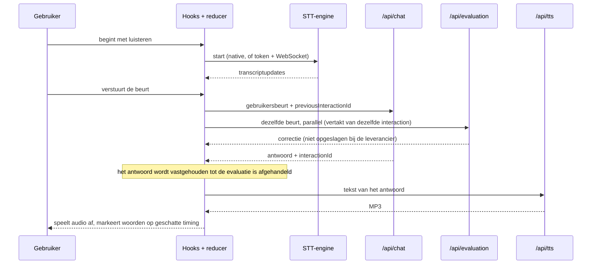

# Software-architectuur — language-buddy

**Perspectief.** De technische blik: wat de componenten zijn, hoe ze samenhangen, hoe credentials
zich verplaatsen en wat er per omgeving verschilt. De frontend komt aan bod als structuur — welke
componenten er zijn en hoe state en acties erdoorheen stromen — niet als product of visueel
ontwerp: tekst, layout en het design system zijn een ander perspectief en worden hier niet
behandeld (zie daarvoor `src/components/CLAUDE.md` en ADR-022 (Design system overgenomen uit de bestaande app)).

**Leeswijzer.**

- Wil je de hele keten: sectie 1 en 4.
- Werk je aan een provider of een route: sectie 3 en 6.
- Werk je aan een scherm of een component: sectie 2 en 3.
- Raak je deployment of env vars aan: sectie 5 en 6.

**Bron van beslissingen.** Elke hier genoemde beslissing verwijst naar een record onder
`docs/grootboek/` (ADR, PDR of HDR), met id en titel. De beslissingen die vroeger in
`docs/plan.md` stonden, zijn naar zulke records verhuisd toen het plan verviel (HDR-015,
plan.md vervalt als bron; beslissingen leven in het grootboek). Een keuze die als *kandidaat*
is gemarkeerd, zie je in de code maar heeft nergens een beslissingsrecord.

## 1. Het systeem en de keuzes die het mogelijk maken

Een browserapp waarmee één persoon gesproken gesprekken in een vreemde taal oefent tegen een
AI-persona: spraak erin, een antwoord van een taalmodel, spraak eruit, met een correctie per
beurt.

1. **De server is stateless.** Elke route is een gewone request/response-handler; geen
   langlevend proces en geen eigen WebSocket-server. De gespreksgeschiedenis leeft bij de
   modelleverancier en wordt geketend met `previous_interaction_id`; de server bewaart niets.
   *Beslissing:* ADR-014 (Hosting: Vercel), PDR-002 (Geen persistentie), ADR-019 (Chat-API en
   gespreksgeschiedenis).
2. **Geen key van een leverancier bereikt de browser.** Keys zijn env vars aan de
   serverkant. Services waarmee de browser rechtstreeks moet praten (live spraakherkenning
   via WebSocket) krijgen een kortlevend token dat een van onze routes aanmaakt. *Beslissing:*
   ADR-014 (Hosting: Vercel), ADR-011 (Deepgram-provider), ADR-012 (ElevenLabs
   Scribe-provider); de reden staat ook in commentaar in de tokenroutes.
3. **Eén reducer is de enige schrijver van sessiestate; effecten leven in hooks.** State
   verandert alleen via acties naar een pure reducer; de hooks sturen het netwerk en de audio aan
   en dispatchen de resultaten. *Beslissing:* ADR-018 (Sessiestate: één reducer, beurtstatus als
   discriminated union).
4. **Providers vallen onder registries en een onbekende instelling faalt luid.** TTS- en
   STT-engines worden gekozen met een env var; een typfout gooit een fout met de geldige namen
   in plaats van stilletjes een andere provider te kiezen. *Beslissing:* ADR-020
   (TTS-providers en stemmen), ADR-009 (STT: providerkeuze en configuratie); de reden voor "geen
   fallback" staat in het commentaar van de registries.

## 2. Componentenkaart

Slechts vier componenten roepen `useSessionDispatch()` rechtstreeks aan: `ComposingControls`,
`IdleControls`, `ErrorControls` en de dev-only `StateStepper`. Al het andere in
`SCREENS` en de presentationele onderdelen tussen `SCREENS` en `CTRL` (de thread, de bubbels,
de weergave van de evaluatie, de velden van het setupformulier) ontvangt alleen state en callbacks
als props — ze raken de reducer nooit rechtstreeks aan.

## 3. Componenten: verantwoordelijkheden en beslissingen

| Component | Verantwoordelijkheid | Beslissing erachter |
|---|---|---|
| Session reducer (`src/lib/session-reducer.ts`) | De state machine: setup versus gesprek, en de union van beurtstatussen. De enige schrijver van sessiestate. | ADR-018 (Sessiestate: één reducer, beurtstatus als discriminated union) |
| Effect hooks (`src/hooks/`) | Eén driver per aspect: chatcall, evaluatiecall, audio afspelen, live transcriptie, mock-TTS. Elk reageert op een beurtstatus en dispatcht resultaten. | ADR-018 (Sessiestate: één reducer, beurtstatus als discriminated union) |
| TTS-registry en -providers (`src/lib/tts/`) | Kiezen één provider via `TTS_PROVIDER` (standaard Azure), zetten tekst om in MP3. Stemtabellen leven in elke provider zelf. | ADR-020 (TTS-providers en stemmen) |
| STT-registry en -providers (`src/lib/stt/`) | Kiezen één engine via `NEXT_PUBLIC_STT_PROVIDER` (standaard native): native Web Speech, Deepgram, ElevenLabs Scribe. Eén contract voor de startfunctie. | ADR-009 (STT: providerkeuze en configuratie) |
| Chat- en evaluatieroutes (`src/app/api/chat`, `evaluation`) | Roepen Gemini aan: de gespreksbeurt, en een aparte correctie van de beurt van de gebruiker. Foutdetails blijven in het serverlog. | ADR-007 (Evaluatie per beurt, in een eigen call), ADR-019 (Chat-API en gespreksgeschiedenis) |
| TTS-route (`src/app/api/tts`) | Valideert de body, synthetiseert met de geconfigureerde provider, geeft audio terug. Het geslacht van de stem staat op de server vast. | ADR-020 (TTS-providers en stemmen) |
| Tokenroutes (`src/app/api/stt/*-token`) | Wisselen de key aan de serverkant om voor een kortlevend token voor de browser. | ADR-011 (Deepgram-provider), ADR-012 (ElevenLabs Scribe-provider) |
| Mockroutes (`src/app/api/mock/*`) | Vooraf vastgelegde chat- en evaluatieantwoorden; 404 buiten development. | ADR-025 (Mockmodus voor ontwikkeling) |
| Prompt builder (`src/lib/prompt.ts`) | Bouwt bij elke request de system instruction voor de chatcall en voor de correctiecall. | ADR-019 (Chat-API en gespreksgeschiedenis), ADR-008 (Prompts van de corrector) |
| Contracten (`src/lib/chat-schema.ts`, `tts/types.ts`, `stt/types.ts`) | De vorm van request en response en de providerinterfaces, gedeeld door routes, hooks en providers. | ADR-020 (TTS-providers en stemmen), ADR-019 (Chat-API en gespreksgeschiedenis) |
| App shell (`src/app/layout.tsx`, `page.tsx`, `manifest.ts`) | Lettertypen, PWA-manifest, globale CSS, mount `LanguageBuddy` als de ene pagina. | — |
| `LanguageBuddy` (`src/components/language-buddy.tsx`) | Bezit de reducer, koppelt elke effect hook, rendert precies één scherm voor de huidige `phase`, levert `dispatch` via context. | ADR-018 (Sessiestate: één reducer, beurtstatus als discriminated union) |
| Schermen (`SetupScreen`, `ConversationScreen`) en de presentationele onderdelen eronder (thread, bubbels, weergave van de evaluatie, formuliervelden) | Ontvangen state en callbacks als props; renderen; roepen `dispatch` nooit rechtstreeks aan. | ADR-018 (Sessiestate: één reducer, beurtstatus als discriminated union) |
| Thread en AI-bubbel (`src/components/conversation/conversation-thread.tsx`, `ai-bubble.tsx`) | Rendert de beurten en de wachtbubbel in één array. De AI-bubbel is één element van wachten tot antwoord (key op positie, `ai-<n>`); de layout staat meteen op de eindmaat en alleen `scale` animeert, zodat het scroll-effect ongewijzigd blijft. | ADR-031 (De AI-bubbel blijft één element, van wachten tot antwoord), PDR-013 (Animatie van bubbels) |
| Leaf controls (`ComposingControls`, `IdleControls`, `ErrorControls`, dev-only `StateStepper`) | De enige componenten die `useSessionDispatch()` aanroepen. `ConversationControls` schakelt op `turnState.name` om precies één ervan te renderen. | De code (`src/components/conversation/conversation-controls.tsx`); geen record |
| Dev-previews (`src/components/dev/`: `UserBubblePreview`, `AiBubblePreview`) | Alleen in development: `ConversationThread` mount ze achter `NODE_ENV === "development"`. Elk leest een eigen kleine store (`useSyncExternalStore`) die `StateStepper` vult. Bewust buiten de reducer, want een echte beurt zou de chat- en evaluatiedrivers starten. Geen sessiestate. | JNL-003 (Animatie van chatbubbels), K11; nog geen record |

## 4. Kern van de datastroom: één gespreksbeurt

**Grenzen aan het wachten:** de chatcall heeft een client-side deadline van 30 s en de evaluatie
10 s; de deadline van de evaluatie is dus het langst dat een antwoord kan worden vastgehouden. Het
afspelen wordt iets vóór het einde van de audio afgekapt, vanwege een probleem dat op de iPhone
is waargenomen (oorzaak onbekend; JNL-004 (Openstaande kwesties), K9; mitigatie in ADR-010 (Native
engine op iPhone: herstart en twee mitigaties)).

**Huidig model, expliciet gemarkeerd:** de evaluatie is een aparte call die van het gesprek
vertakt en niet in de keten terugkeert; het AI-antwoord wordt vastgehouden tot de evaluatie van
de voorgaande beurt is afgehandeld, zodat een correctie nooit na het antwoord verschijnt. Het
markeren van woorden gebruikt een schatting uit de tekstlengte, niet de timing van de provider.

**Waar de twee gebruikersacties in het diagram vandaan komen:** "begint met luisteren" is
`IdleControls` die `LISTENING_STARTED` dispatcht; "verstuurt de beurt" is `ComposingControls`
die `USER_TURN_SENT` dispatcht. Beide zijn leaf controls (zie sectie 3); niets tussen hen en
`LanguageBuddy` raakt de reducer aan.

## 5. Omgevingen

| | Lokale development | Gedeployd |
|---|---|---|
| Draait als | `next dev`, eventueel achter een HTTPS-tunnel voor iPhone-tests (de dev-server staat `*.ngrok-free.app` toe) | Vercel (genoemd in de README en ADR-014, Hosting: Vercel; geen configuratiebestand in de repo) |
| Mock chat / evaluatie | `NEXT_PUBLIC_USE_MOCK_CHAT` schakelt beide samen; de mockroutes antwoorden alleen in development | Mockroutes geven 404 |
| Mock-TTS | `NEXT_PUBLIC_USE_MOCK_TTS` | Niet beperkt tot development: hij draait in de browser, dus er is geen servercontrole (ADR-025, Mockmodus voor ontwikkeling) |
| Providerkeuze | `TTS_PROVIDER` (server), `NEXT_PUBLIC_STT_PROVIDER` (bij de build ingebakken) | dezelfde variabelen |

`main` is de productiebranch; elke andere branch deployt als Vercel-preview met de
standaardinstellingen van Vercel, dus niets behalve een merge in `main` bereikt productie
(ADR-001; dit is geconfigureerd in het Vercel-dashboard, niet in de repo). De `NEXT_PUBLIC_*`-variabelen
staan ook voor Preview aan; de API-keys staan alleen voor Production aan, dus een preview
bouwt wel maar de routes die een leverancier aanroepen falen tijdens runtime en hij kan geen key
uitgeven. Vercel Authentication is actief met Standard Protection: previews vragen om een
Vercel-login; het productiedomein is publiek (ADR-002 behandelt wat dat openlaat).
De checks uit `CLAUDE.md` draaien ook in CI: `.github/workflows/checks.yml` draait lint,
typecheck, `docs:check`, `test:scripts`, `register:check` en build op elke pull request naar
`main` (HDR-003, De checks van de repo draaien op pull requests naar `main`; JNL-001, K8).

## 6. Authenticatie tussen diensten

| Relatie | Mechanisme | Geheim / variabele | Waar het leeft |
|---|---|---|---|
| Server → Gemini | API-key | `GEMINI_API_KEY` | alleen server |
| Server → Azure TTS | header met subscription key | `AZURE_SPEECH_API_KEY`, `AZURE_SPEECH_REGION` | alleen server |
| Server → Google TTS | API-key als header (`x-goog-api-key`) | `GOOGLE_CLOUD_API_KEY` | alleen server |
| Server → ElevenLabs TTS | key-header | `ELEVENLABS_API_KEY` | alleen server |
| Server → ElevenLabs tokenservice | key-header; geeft een eenmalig token terug | `ELEVENLABS_API_KEY` | alleen server |
| Browser → ElevenLabs Scribe | eenmalig token als queryparameter op de WebSocket-URL | token uit onze route | browser, kortlevend |
| Server → Deepgram grant | `Authorization`-header (Token-schema); geeft een toegangstoken terug | `DEEPGRAM_API_KEY` | alleen server |
| Browser → Deepgram | toegangstoken als WebSocket-subprotocol `Bearer` | token uit onze route | browser, kortlevend |
| Browser → onze routes | geen gevonden | geen | — |

Bewust publiek: `NEXT_PUBLIC_STT_PROVIDER`, `NEXT_PUBLIC_USE_MOCK_CHAT`,
`NEXT_PUBLIC_USE_MOCK_TTS` (ze komen in de clientbundle terecht). Waar twee platforms over een
geheim moeten overeenstemmen: geen gevonden.

## 7. Gedeelde contracten

| Contract | Gedefinieerd in | Gebruikt door |
|---|---|---|
| Sessiestate, beurtstatus, acties | `src/lib/session-reducer.ts` | elke effect hook en de schermen |
| Request/response van chat en evaluatie (zod; de chatrequest is een union met discriminator `kind`) | `src/lib/chat-schema.ts` | hooks en routes |
| TTS-provider en request-body | `src/lib/tts/types.ts` | TTS-providers, registry, route, afspeelhook |
| STT-startfunctie en callbacks | `src/lib/stt/types.ts` | de drie STT-engines en de hook voor live transcriptie |
| Talen (taalcodes per leverancier) | `src/lib/languages.ts` | STT- en TTS-providers, prompt builder |

## 8. Technologiekeuzes, en wat niet is gekozen

| Keuze | Reden | Niet gekozen |
|---|---|---|
| Next.js App Router + TypeScript strict | ADR-013 (Next.js 16 met TypeScript strict) | — |
| Vercel-hosting | ADR-014 (Hosting: Vercel) | een langlevend serverproces |
| CSS Modules | ADR-015 (Styling: CSS Modules over het overgenomen design system) | Tailwind |
| `useReducer` + dispatch-context | ADR-018 (Sessiestate: één reducer, beurtstatus als discriminated union) | een state-managementbibliotheek |
| Gemini voor chat en correctie | De provider stond vooraf vast; het model (`flash-lite`) is op prijs gekozen, zonder uitgebreide vergelijking (ADR-003, Gemini `flash-lite` als model, gekozen op prijs) | andere modellen zijn niet vergeleken |
| Azure TTS als standaard | ADR-020 (TTS-providers en stemmen) | — |
| Native Web Speech als standaard-STT | ADR-009 (STT: providerkeuze en configuratie) | Google Cloud STT en Azure STT, uitgesloten in de spike (ADR-009, Voorgeschiedenis) |
| Geen persistentie | PDR-002 (Geen persistentie) | gesprekken opslaan |

## 9. Beveiligingsprincipes en waar ze leven

| Principe | Implementatie |
|---|---|
| Een key van een leverancier bereikt de client nooit | keys worden alleen in servercode gelezen; de browser krijgt aangemaakte tokens |
| Foutdetails van providers blijven uit responses | de routes loggen het detail en geven een algemene melding terug |
| De mock-chat- en -evaluatieroutes kunnen in productie niet antwoorden | ze geven 404 tenzij `NODE_ENV` `development` is. De TTS-mock is een vlag in de browser zonder zo'n poort (zie sectie 5) |
| Waarden die in een system prompt terechtkomen zijn begrensd | `language` en `level` zijn zod-enums in het requestschema |
| De omvang van invoer is begrensd | de chatinvoer en de tekst die naar TTS gaat hebben lengtelimieten in hun zod-schema's |
| Een verlaten request stopt de call naar de leverancier | het requestsignaal van de route wordt doorgegeven aan de Gemini- en TTS-calls |
| Aanroepers van onze eigen routes | geen principe gevonden; geen authenticatie of rate limit in de repo. Het risico is voorlopig geaccepteerd en een oplossing is binnenkort gewenst (ADR-002, voorlopig; JNL-001, K7) |

## 10. Hoe dit document verandert

Eerst de beslissing (een record: een ADR, PDR of HDR), dan de aanpassing van dit document, en
de mens krijgt te horen wat er veranderd is en wordt om een check gevraagd. Feiten die snel
bewegen (versies van dependencies, aantallen regels, de lijst met providers) worden uit de code
gemeten en hier niet bewaard. Secties zonder beslissing erachter zeggen dat. Een eerlijk gat is
beter dan plausibele opvulling.
